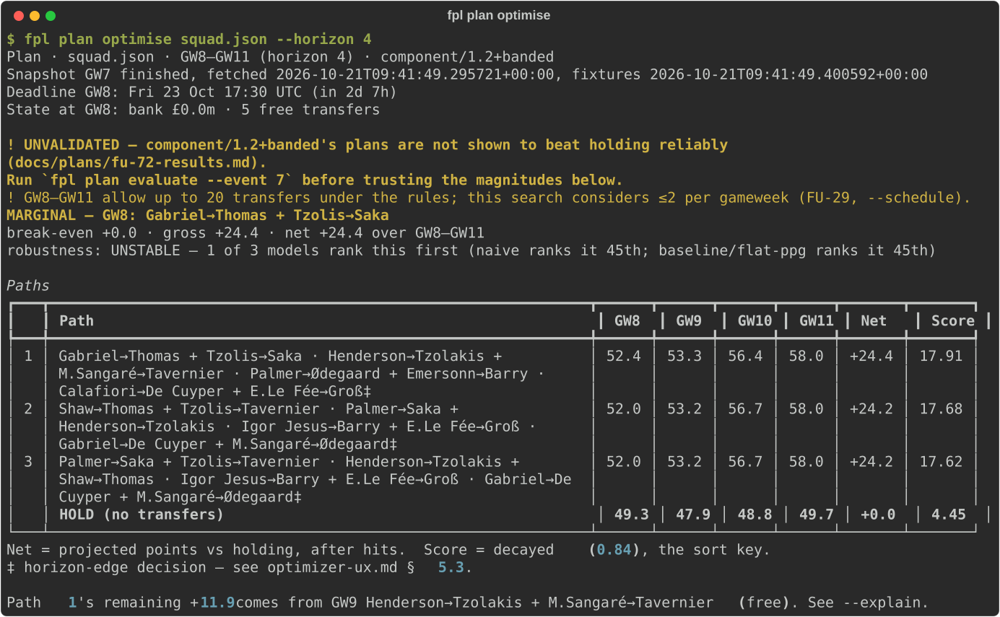
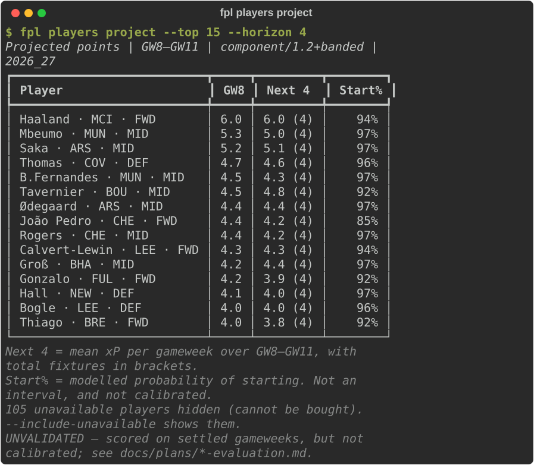
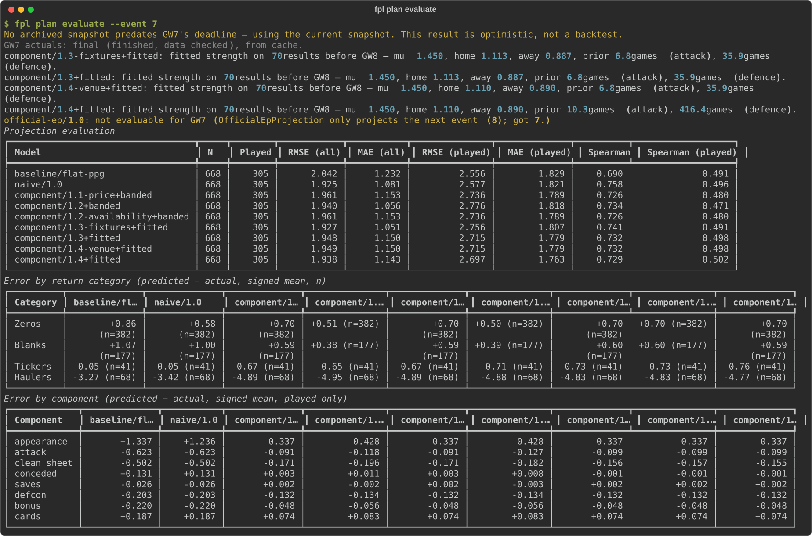

# FPL CLI

A command-line planner for **Fantasy Premier League**. It projects every
player's points gameweek by gameweek, searches multi-week transfer plans with
a custom optimiser, and scores its own forecasts against what actually
happened. It is read-only: it uses the official FPL API, needs no login and
never changes your team.



**Stack:** Python 3.12 · Typer · Rich · HTTPX · Pydantic · NumPy · pytest ·
respx · SciPy (MILP oracle)

**At a glance:** ~8,600 lines of application code · ~13,000 lines of tests ·
507 tests, no network needed · 13 registered projection models · 40+ written
design documents

---

## Highlights

- **An eight-component points model.** Expected points are broken into
  appearance, attack, clean sheet, goals conceded, saves, defensive
  contribution, bonus and cards. Each component is priced from the scoring
  rules in the live API, not a hardcoded table, so a rule change is picked up
  automatically.
- **Fitted team strength.** Fixture difficulty is modelled as expected goals
  for and against, with team attack and defence ratings fitted from the
  season's results. A clean-sheet probability falls out as `exp(-xG against)`.
- **A custom multi-week optimiser.** Beam search with an exactly enumerated
  first gameweek, a NumPy scoring kernel, and dominance pruning that removes
  players who can never be worth picking. A MILP formulation was evaluated and
  rejected for this objective, for reasons that are written down. A separate
  MILP "oracle" (SciPy/HiGHS) computes the true optimum after the fact, to
  measure how much the search leaves on the table.
- **It grades its own confidence.** Every recommendation is re-ranked under
  rival models and labelled ROBUST, MARGINAL or UNSTABLE, and the CLI prints an
  UNVALIDATED banner until the model has earned trust.
- **An evaluation harness.** `fpl plan evaluate` scores every model against a
  finished gameweek on RMSE, MAE and Spearman rank correlation, broken down by
  return category and by points component, so it shows which part of the model
  is wrong.
- **Reproducible runs.** `fpl sync` writes dated, checksummed captures of the
  API data. Any command can be pinned to a capture, so a quoted number can
  always be re-measured from the inputs that produced it.

## Screenshots

**Player projections:** expected points over the next four gameweeks, with each
player's modelled probability of starting.



**Model evaluation:** nine models scored against gameweek 7's actual points, with
errors split by return category and by points component.



## Quickstart

```bash
git clone https://github.com/benw312/fpl.git
cd fpl
python3 -m venv .venv && source .venv/bin/activate
pip install -e ".[dev]"

fpl sync                                  # fetch and archive the latest data
fpl players project --top 20              # who the model rates
fpl squad create                          # build your squad interactively
fpl plan optimise squad.json --horizon 4  # search transfer plans
```

A sample squad is included as `squad.json`.

## Commands

| Command | What it does |
|---|---|
| `fpl sync` | Fetch, cache and archive the current API snapshot and fixtures. |
| `fpl players list` | List and filter players. |
| `fpl players project` | Rank players by projected points over a horizon. |
| `fpl squad create` | Build a 15-player squad interactively. |
| `fpl squad validate` | Check a squad against the current rules: budget, positions, club limits. |
| `fpl plan simulate` | Apply a transfer plan gameweek by gameweek, with hits and selling prices. |
| `fpl plan optimise` | Search and rank transfer paths over a horizon. |
| `fpl plan evaluate` | Score the projection models against a finished gameweek. |

Run any command with `--help` for its options.

## How it's built

```
src/fpl_cli/
├── cli.py, presentation.py   # Typer commands and Rich rendering
├── transport.py              # HTTP client: timeouts, retries, polite 429 handling
├── api/                      # FPL endpoints, Pydantic models, snapshot cache logic
├── domain/                   # Pure logic, no I/O
│   ├── rules.py, squad.py    #   rules read from the API; squad and XI validation
│   ├── transfers.py          #   transfer ledger, free transfers, hits, selling prices
│   ├── projections.py        #   the eight-component points model
│   ├── strength.py           #   fixture strength: banded and fitted team ratings
│   ├── variants.py           #   the registry of named model versions
│   ├── optimizer.py          #   beam search, scoring kernel, dominance pruning
│   └── evaluation.py         #   RMSE / MAE / Spearman scoring
└── storage/                  # raw JSON cache and the capture archive
tools/                        # offline research scripts and the MILP oracle
docs/plans/                   # design documents and experiment write-ups
```

The domain layer is pure and fully unit-tested. Every plan the optimiser
proposes is replayed through the same validator used for manual planning, so
it cannot recommend an illegal squad.

## Engineering approach

- **Plan first.** Each substantial change starts as a design document in
  [`docs/plans/`](docs/plans/) that records what was measured, what was
  assumed, and which alternatives were rejected and why. Model changes are
  pre-registered: the acceptance criteria are written down before the
  evaluation data exists, so a result can't be rationalised after the fact.
- **Tests that are proven to catch something.** Each new assertion is kept only
  after it has been seen failing against the bug it targets. Tests use
  synthetic data and mocked HTTP, and never call the live API.
- **Checks instead of manual corrections.** When documentation drifted from the
  code more than once, the fix was a test: the architecture and command tables
  in the technical docs are checked against the source tree and the CLI app.
- **AI-assisted.** Built with an AI coding agent working under these rules.
  The plans double as hand-off notes between working sessions.

## Honest limitations

The tool states its own uncertainty rather than hiding it:

- The projection constants were chosen by reasoning rather than fitted to data,
  and the models have only been scored over the gameweeks played so far this
  season.
- Plans have beaten "hold" only modestly on settled gameweeks. Most of the
  error is in the forecast, not the search.
- The search considers up to two transfers per gameweek, and chips are not yet
  modelled.

The full design rationale, measured results and known issues are in
[docs/TECHNICAL.md](docs/TECHNICAL.md).

## Roadmap

- Dixon-Coles team strength, fitted on raw scorelines.
- Per-gameweek underlying stats (xG, xA) derived by differencing daily captures.
- User-fixed transfer schedules, to reach three or more transfers in a gameweek.
- Machine-learned projections, once enough leak-free gameweeks have accumulated
  to train and test against.

## License

[MIT](LICENSE) © 2026 Ben Wallbridge
